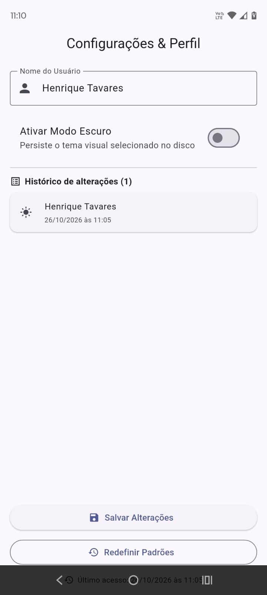

# Configurações & Perfil — Persistência Local

Roteiro Prático da Aula 12 — Armazenamento Chave-Valor e Preferências de Usuário
Programação para Dispositivos Móveis I · FATEC Matão · 2026/2

---

## Sobre o projeto

Quando um aplicativo é encerrado, tudo que estava em memória RAM é liberado
pelo sistema operacional. Para que preferências como tema, idioma e nome de
perfil sobrevivam ao fechamento, é preciso gravá-las no armazenamento do
dispositivo.

Este aplicativo usa o pacote oficial `shared_preferences` para persistir pares
chave-valor, com toda a lógica de acesso encapsulada em um serviço reutilizável.

## Arquitetura

| Arquivo | Responsabilidade |
|---|---|
| `lib/services/preferences_service.dart` | Isola as chaves e os métodos de leitura e escrita |
| `lib/screens/configuracoes_screen.dart` | Formulário de preferências e histórico |
| `lib/main.dart` | Lê o tema do disco antes de montar o app e gerencia a alternância |

## Como a persistência funciona

O `shared_preferences` grava em um arquivo XML no Android e em um `.plist` no
iOS, abstraindo essa diferença sob a mesma API Dart. Ele aceita apenas tipos
simples: `String`, `int`, `double`, `bool` e `List<String>`.

Todas as operações são assíncronas porque envolvem acesso a disco. Por isso o
`main()` é `async` e chama `WidgetsFlutterBinding.ensureInitialized()` antes de
qualquer leitura — sem essa linha, a ponte entre Dart e o código nativo ainda
não está pronta e o plugin falha.

As chaves ficam como constantes privadas dentro do serviço. Se fossem strings
literais espalhadas pelas telas, um erro de digitação faria o app gravar em uma
chave e ler de outra, e a falha seria silenciosa — a leitura simplesmente
devolveria o valor padrão.

## Carga inicial sem tela em branco

O `initState()` não pode ser `async`, então ele dispara o carregamento e retorna
imediatamente. Nesse instante o `build()` já é executado, antes de os dados
chegarem do disco.

A flag `_carregando` cobre essa janela com um `CircularProgressIndicator`. Sem
ela, a interface tentaria renderizar campos ainda não preenchidos.

## Funcionalidades

**Base do roteiro**

- Campo de nome persistido com `setString` / `getString`
- Switch de modo escuro persistido com `setBool` / `getBool`
- Tema restaurado no `main()` antes da montagem do aplicativo
- Valores padrão aplicados com `??` na primeira execução

**Desafio Básico — Data do último acesso**

O rodapé exibe quando o aplicativo foi aberto pela vez anterior. A ordem das
operações é o que torna isso correto: o valor salvo é **lido primeiro** e só
então o acesso atual é gravado. Na ordem inversa, o rodapé mostraria sempre o
horário atual.

A data é armazenada no formato produzido por `DateTime.now().toString()`, que
o `DateTime.tryParse` consegue ler de volta — a formatação para exibição
acontece só na interface, mantendo o dado reutilizável.

**Desafio Intermediário — Redefinir padrões**

Botão que chama `limparTudo()` e restaura nome, tema e histórico aos valores
iniciais. Como é uma ação destrutiva, pede confirmação em um `AlertDialog`.

Além de limpar o disco, o método notifica o `main.dart` através do callback
`onTemaAlterado(false)`. Sem isso, a preferência seria apagada mas o aplicativo
continuaria escuro, porque a variável em memória não teria sido atualizada.

**Desafio Avançado — Histórico em JSON**

Cada salvamento registra uma entrada com nome, tema e data. Como o
`shared_preferences` não armazena objetos, a `List<Map>` é serializada:

```dart
await prefs.setString(_keyHistorico, jsonEncode(limitado));
```

Na leitura, `jsonDecode` desfaz a conversão. O resultado precisa passar por
`Map<String, dynamic>.from(item)`, já que o decodificador devolve `dynamic` —
sem essa conversão o código compila mas falha na primeira leitura.

A leitura é protegida por `try / catch`: um JSON corrompido devolve lista vazia
em vez de impedir a abertura do aplicativo. O histórico é limitado aos dez
registros mais recentes, pois a string é regravada inteira a cada gravação.

## Capturas de tela

| Tema claro | Tema escuro |
|:---:|:---:|
|  |  |

O tema selecionado é gravado no disco e restaurado na próxima abertura do
aplicativo, sem depender do estado em memória.

## Testes

```bash
flutter test
```

Dezenove testes cobrem o projeto em duas camadas, usando
`SharedPreferences.setMockInitialValues()` para substituir o armazenamento real
por um mapa em memória — os testes rodam sem disco e sem emulador.

- **Serviço** — valores padrão na primeira execução, escrita e leitura de cada
  chave, limpeza total, e o ciclo completo do histórico: inserção no topo,
  limite de dez registros, preservação de tipos após a serialização e
  recuperação diante de JSON corrompido.
- **Tela** — indicador de carregamento, preenchimento com os valores do disco,
  gravação com notificação de tema, inclusão no histórico exibido, e os dois
  caminhos do diálogo de redefinição (confirmar e cancelar).

## Como executar

```bash
flutter pub get
flutter run
```

Para verificar a persistência, encerre o aplicativo por completo (`q` no
terminal) e execute novamente: o tema e o nome devem ser restaurados.

## Histórico de commits

```
feat: cria PreferencesService para isolamento do SharedPreferences
feat: implementa tela de configuracoes com persistencia de tema e perfil
feat: registra e exibe a data do ultimo acesso
feat: adiciona redefinicao de preferencias com confirmacao
feat: persiste historico de alteracoes com jsonEncode e jsonDecode
test: cobre service, persistencia em JSON e fluxo da tela
chore: adiciona estrutura base do projeto Flutter
docs: adiciona capturas de tela do app em execucao
```

## Tecnologias

Flutter · Dart · Material Design 3 · pacote `shared_preferences`